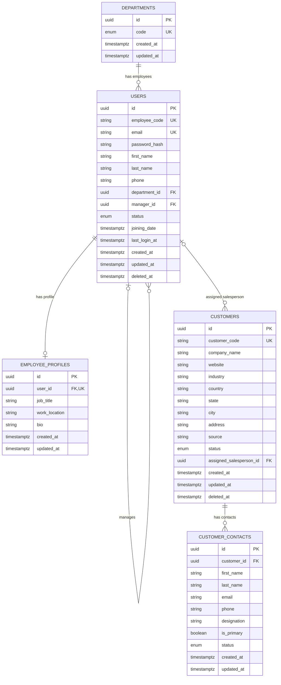

# Employee and customer ERD

Organization boundary: this system serves InterSmart Technologies only. Do not
add an organizations table, `tenant_id`, or `organization_id`.

`customer_contacts.customer_id` has a partial unique index only for rows where
`is_primary = true`. Non-primary contacts are unrestricted in number. Neither
customers nor their contacts authenticate or participate in employee access
control.
