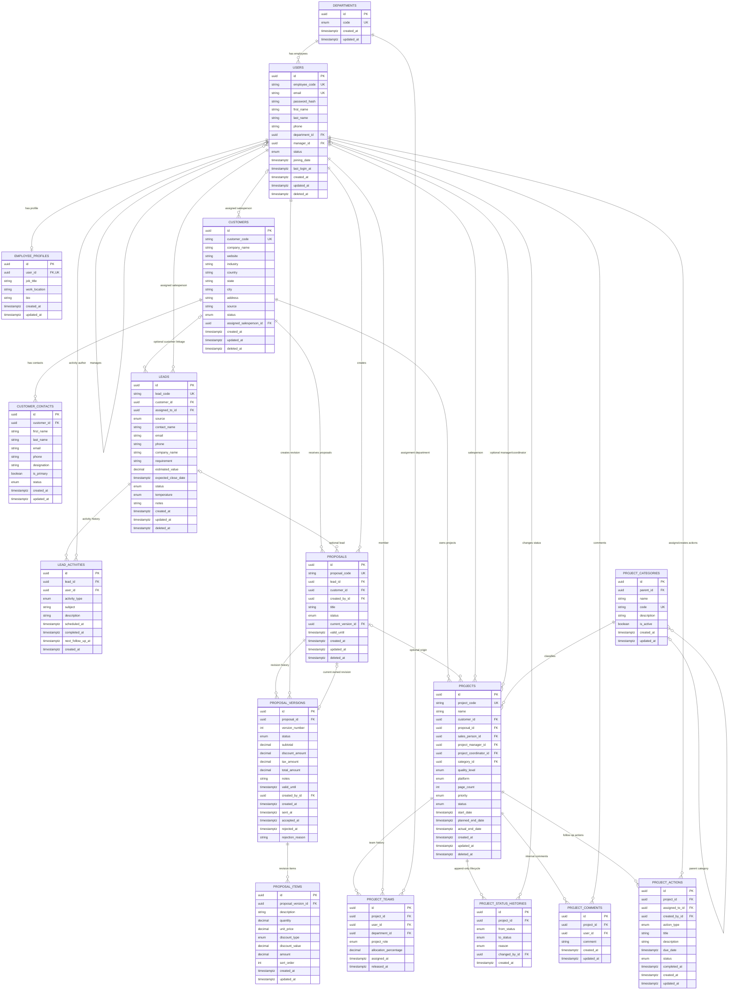

# InterSmart ERP employee, sales, and project-core ERD

Organization boundary: this system serves InterSmart Technologies only. Do not
add an organizations table, `tenant_id`, or `organization_id`.

`customer_contacts.customer_id` has a partial unique index only for rows where
`is_primary = true`. Non-primary contacts are unrestricted in number. Neither
customers nor their contacts authenticate or participate in employee access
control.

`leads.customer_id` is nullable; employee assignment is required. Lead soft
deletion retains activities. Hard deletion of leads with activity history and
users with lead assignments/authored activities is restricted.

Proposal lead linkage is nullable, customer/creator linkage required. Version
`(proposal_id, version_number)` and `(proposal_id, id)` are composite unique
keys. Current selection uses `(proposals.id, current_version_id)` to reference
`(proposal_versions.proposal_id, id)`, ensuring the selected version belongs
to the same proposal. Item ordering is indexed by `(proposal_version_id,
sort_order)`; sort-order values need not be unique.

Project's customer, salesperson, and category are required; proposal, manager,
and coordinator are nullable. Team membership is unique by `(project_id,
user_id)` only while `released_at IS NULL`. History records store optional
reasons separately from lifecycle status and cannot be updated/deleted.
No resource-specific employee fields or calculated financial/work totals are
stored on Project.
