# InterSmart ERP employee, sales, and project-core ERD

```mermaid
erDiagram
  PROJECTS ||--o| PROJECT_BUDGETS : "budget definition"
  USERS ||--o{ PROJECT_BUDGETS : "creates"
  USERS o|--o{ PROJECT_BUDGETS : "last updates"
  PROJECT_BUDGETS ||--o{ BUDGET_ALLOCATIONS : "plans allocations"
  DEPARTMENTS o|--o{ BUDGET_ALLOCATIONS : "optional department"
  USERS o|--o{ BUDGET_ALLOCATIONS : "optional employee target"
  USERS ||--o{ BUDGET_ALLOCATIONS : "creates"
  PROJECT_BUDGETS ||--o{ BUDGET_TRANSACTIONS : "financial events"
  BUDGET_ALLOCATIONS o|--o{ BUDGET_TRANSACTIONS : "optional same-budget attribution"
  USERS ||--o{ BUDGET_TRANSACTIONS : "records"

  PROJECT_BUDGETS {
    uuid id PK
    uuid project_id FK, UK
    decimal total_budget
    string currency
    enum status
    timestamptz effective_from
    timestamptz effective_until
    string notes
    uuid created_by_id FK
    uuid updated_by_id FK
    timestamptz created_at
    timestamptz updated_at
  }

  BUDGET_ALLOCATIONS {
    uuid id PK
    uuid project_budget_id FK
    uuid department_id FK
    uuid user_id FK
    enum allocation_type
    decimal allocated_amount
    string description
    uuid created_by_id FK
    timestamptz created_at
    timestamptz updated_at
  }

  BUDGET_TRANSACTIONS {
    uuid id PK
    uuid project_budget_id FK
    uuid allocation_id FK
    enum transaction_type
    decimal amount
    string reference
    string description
    timestamptz transaction_date
    uuid created_by_id FK
    timestamptz created_at
  }
  PROJECTS ||--o{ FILES : "owns physical metadata"
  USERS ||--o{ FILES : "uploads"
  PROJECTS ||--o{ PROJECT_RESOURCES : "classifies resources"
  FILES ||--o{ PROJECT_RESOURCES : "same-project business references"
  USERS ||--o{ PROJECT_RESOURCES : "uploads resource reference"

  FILES {
    uuid id PK
    uuid project_id FK
    uuid file_series_id
    uuid uploaded_by_id FK
    string file_name
    string original_name
    string storage_key UK
    string bucket
    string mime_type
    bigint size_bytes
    string checksum
    int version
    boolean is_current
    timestamptz created_at
    timestamptz updated_at
    timestamptz deleted_at
  }

  PROJECT_RESOURCES {
    uuid id PK
    uuid project_id FK
    uuid file_id FK
    uuid resource_series_id
    enum resource_type
    string title
    string description
    int version
    boolean is_current
    uuid uploaded_by_id FK
    timestamptz created_at
    timestamptz updated_at
  }
  DEPARTMENTS ||--o{ USERS : "has employees"
  USERS o|--o{ USERS : "manages"
  USERS ||--o| EMPLOYEE_PROFILES : "has profile"
  USERS o|--o{ CUSTOMERS : "assigned salesperson"
  CUSTOMERS ||--o{ CUSTOMER_CONTACTS : "has contacts"
  CUSTOMERS o|--o{ LEADS : "optional customer linkage"
  USERS ||--o{ LEADS : "assigned salesperson"
  LEADS ||--o{ LEAD_ACTIVITIES : "activity history"
  USERS ||--o{ LEAD_ACTIVITIES : "activity author"
  CUSTOMERS ||--o{ PROPOSALS : "receives proposals"
  LEADS o|--o{ PROPOSALS : "optional lead"
  USERS ||--o{ PROPOSALS : "creates"
  PROPOSALS ||--o{ PROPOSAL_VERSIONS : "revision history"
  USERS ||--o{ PROPOSAL_VERSIONS : "creates revision"
  PROPOSAL_VERSIONS o|--o| PROPOSALS : "current owned revision"
  PROPOSAL_VERSIONS ||--o{ PROPOSAL_ITEMS : "revision items"
  CUSTOMERS ||--o{ PROJECTS : "owns projects"
  PROPOSALS o|--o{ PROJECTS : "optional origin"
  USERS ||--o{ PROJECTS : "salesperson"
  USERS o|--o{ PROJECTS : "optional manager/coordinator"
  PROJECT_CATEGORIES ||--o{ PROJECTS : "classifies"
  PROJECT_CATEGORIES o|--o{ PROJECT_CATEGORIES : "parent category"
  PROJECTS ||--o{ PROJECT_TEAMS : "team history"
  USERS ||--o{ PROJECT_TEAMS : "member"
  DEPARTMENTS ||--o{ PROJECT_TEAMS : "assignment department"
  PROJECTS ||--o{ PROJECT_STATUS_HISTORIES : "append-only lifecycle"
  USERS ||--o{ PROJECT_STATUS_HISTORIES : "changes status"
  PROJECTS ||--o{ PROJECT_COMMENTS : "internal comments"
  USERS ||--o{ PROJECT_COMMENTS : "comments"
  PROJECTS ||--o{ PROJECT_ACTIONS : "follow-up actions"
  USERS ||--o{ PROJECT_ACTIONS : "assigns/creates actions"
  PROJECTS ||--o{ PROJECT_SCOPES : "scope revisions"
  PROJECT_SCOPES ||--o{ PROJECT_SCOPE_ITEMS : "included/excluded deliverables"
  USERS ||--o{ PROJECT_SCOPES : "creates"
  USERS o|--o{ PROJECT_SCOPES : "approves"
  PROJECTS ||--o| BUSINESS_ANALYSES : "current business analysis"
  USERS ||--o{ BUSINESS_ANALYSES : "creates"
  USERS o|--o{ BUSINESS_ANALYSES : "last updates"
  BUSINESS_ANALYSES ||--o{ COMPETITORS : "analyses competitors"

  PROJECT_SCOPES {
    uuid id PK
    uuid project_id FK
    int version_number
    string title
    string summary
    string scope_description
    enum status
    uuid created_by_id FK
    uuid approved_by_id FK
    timestamptz approved_at
    timestamptz created_at
    timestamptz updated_at
  }

  PROJECT_SCOPE_ITEMS {
    uuid id PK
    uuid project_scope_id FK
    string name
    string description
    enum item_type
    boolean is_included
    decimal estimated_hours
    int sort_order
    timestamptz created_at
    timestamptz updated_at
  }

  BUSINESS_ANALYSES {
    uuid id PK
    uuid project_id FK, UK
    string purpose
    string about_company
    string target_audience
    string usp
    string conclusion
    uuid created_by_id FK
    uuid updated_by_id FK
    timestamptz created_at
    timestamptz updated_at
  }

  COMPETITORS {
    uuid id PK
    uuid business_analysis_id FK
    string name
    string website
    string description
    string strengths
    string weaknesses
    timestamptz created_at
    timestamptz updated_at
  }

  PROJECTS {
    uuid id PK
    string project_code UK
    string name
    uuid customer_id FK
    uuid proposal_id FK
    uuid sales_person_id FK
    uuid project_manager_id FK
    uuid project_coordinator_id FK
    uuid category_id FK
    enum quality_level
    enum platform
    int page_count
    enum priority
    enum status
    timestamptz start_date
    timestamptz planned_end_date
    timestamptz actual_end_date
    timestamptz created_at
    timestamptz updated_at
    timestamptz deleted_at
  }

  PROJECT_CATEGORIES {
    uuid id PK
    uuid parent_id FK
    string name
    string code UK
    string description
    boolean is_active
    timestamptz created_at
    timestamptz updated_at
  }

  PROJECT_TEAMS {
    uuid id PK
    uuid project_id FK
    uuid user_id FK
    uuid department_id FK
    enum project_role
    decimal allocation_percentage
    timestamptz assigned_at
    timestamptz released_at
  }

  PROJECT_STATUS_HISTORIES {
    uuid id PK
    uuid project_id FK
    enum from_status
    enum to_status
    enum reason
    uuid changed_by_id FK
    timestamptz created_at
  }

  PROJECT_COMMENTS {
    uuid id PK
    uuid project_id FK
    uuid user_id FK
    string comment
    timestamptz created_at
    timestamptz updated_at
  }

  PROJECT_ACTIONS {
    uuid id PK
    uuid project_id FK
    uuid assigned_to_id FK
    uuid created_by_id FK
    enum action_type
    string title
    string description
    timestamptz due_date
    enum status
    timestamptz completed_at
    timestamptz created_at
    timestamptz updated_at
  }

  PROPOSALS {
    uuid id PK
    string proposal_code UK
    uuid lead_id FK
    uuid customer_id FK
    uuid created_by_id FK
    string title
    enum status
    uuid current_version_id FK
    timestamptz valid_until
    timestamptz created_at
    timestamptz updated_at
    timestamptz deleted_at
  }

  PROPOSAL_VERSIONS {
    uuid id PK
    uuid proposal_id FK
    int version_number
    enum status
    decimal subtotal
    decimal discount_amount
    decimal tax_amount
    decimal total_amount
    string notes
    timestamptz valid_until
    uuid created_by_id FK
    timestamptz created_at
    timestamptz sent_at
    timestamptz accepted_at
    timestamptz rejected_at
    string rejection_reason
  }

  PROPOSAL_ITEMS {
    uuid id PK
    uuid proposal_version_id FK
    string description
    decimal quantity
    decimal unit_price
    enum discount_type
    decimal discount_value
    decimal amount
    int sort_order
    timestamptz created_at
    timestamptz updated_at
  }

  LEADS {
    uuid id PK
    string lead_code UK
    uuid customer_id FK
    uuid assigned_to_id FK
    enum source
    string contact_name
    string email
    string phone
    string company_name
    string requirement
    decimal estimated_value
    timestamptz expected_close_date
    enum status
    enum temperature
    string notes
    timestamptz created_at
    timestamptz updated_at
    timestamptz deleted_at
  }

  LEAD_ACTIVITIES {
    uuid id PK
    uuid lead_id FK
    uuid user_id FK
    enum activity_type
    string subject
    string description
    timestamptz scheduled_at
    timestamptz completed_at
    timestamptz next_follow_up_at
    timestamptz created_at
  }

  CUSTOMERS {
    uuid id PK
    string customer_code UK
    string company_name
    string website
    string industry
    string country
    string state
    string city
    string address
    string source
    enum status
    uuid assigned_salesperson_id FK
    timestamptz created_at
    timestamptz updated_at
    timestamptz deleted_at
  }

  CUSTOMER_CONTACTS {
    uuid id PK
    uuid customer_id FK
    string first_name
    string last_name
    string email
    string phone
    string designation
    boolean is_primary
    enum status
    timestamptz created_at
    timestamptz updated_at
  }

  DEPARTMENTS {
    uuid id PK
    enum code UK
    timestamptz created_at
    timestamptz updated_at
  }

  USERS {
    uuid id PK
    string employee_code UK
    string email UK
    string password_hash
    string first_name
    string last_name
    string phone
    uuid department_id FK
    uuid manager_id FK
    enum status
    timestamptz joining_date
    timestamptz last_login_at
    timestamptz created_at
    timestamptz updated_at
    timestamptz deleted_at
  }

  EMPLOYEE_PROFILES {
    uuid id PK
    uuid user_id FK, UK
    string job_title
    string work_location
    string bio
    timestamptz created_at
    timestamptz updated_at
  }
```

Organization boundary: this system serves InterSmart Technologies only. Do not
add an organizations table, `tenant_id`, or `organization_id`.

`customer_contacts.customer_id` has a partial unique index only for rows where
`is_primary = true`. Non-primary contacts are unrestricted in number. Neither
customers nor their contacts authenticate or participate in employee access
control.

`leads.customer_id` is nullable; employee assignment is required. Lead soft
deletion retains activities. Hard deletion of leads with activity history and
users with lead assignments/authored activities is restricted.

Proposal lead linkage is nullable, customer/creator linkage required. Version
`(proposal_id, version_number)` and `(proposal_id, id)` are composite unique
keys. Current selection uses `(proposals.id, current_version_id)` to reference
`(proposal_versions.proposal_id, id)`, ensuring the selected version belongs
to the same proposal. Item ordering is indexed by `(proposal_version_id,
sort_order)`; sort-order values need not be unique.

Project's customer, salesperson, and category are required; proposal, manager,
and coordinator are nullable. Team membership is unique by `(project_id,
user_id)` only while `released_at IS NULL`. History records store optional
reasons separately from lifecycle status and cannot be updated/deleted.
No resource-specific employee fields or calculated financial/work totals are
stored on Project.

Scope `(project_id, version_number)` is unique, and only one scope may have
APPROVED status per project. Approved scope content and items remain frozen
after supersession. Business Analysis has one unique project reference and
separate multiple competitor records; project soft deletion preserves both
scope history and analysis.

Files hold MinIO bucket/key metadata, never binaries or permanent public URLs.
Resources hold classification, not duplicate physical storage metadata.
Resource `(project_id, file_id)` must reference a file's `(project_id, id)`.
Stable series identifiers support multiple assets per type with independent
version histories. File project/series/version and resource
project/type/series/version are unique; at-most-one current per series remains
a future application rule. Restrict FKs and file soft deletion preserve rows.

Budgets are unique by project and never stored directly on Project. Allocation
targets are optional; transaction allocations must belong to the same budget.
All money is NUMERIC(18,2); signed events preserve funding/consumption history.
Configured opening budget and its INITIAL_ALLOCATION are not added twice.
Balances are derived later, with reversal/accounting policies validated by
future services. Customer payments and generic approval remain separate.
